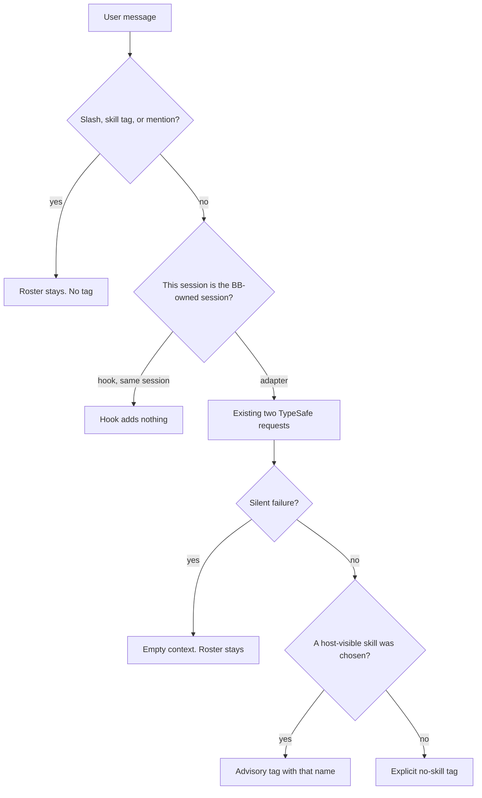
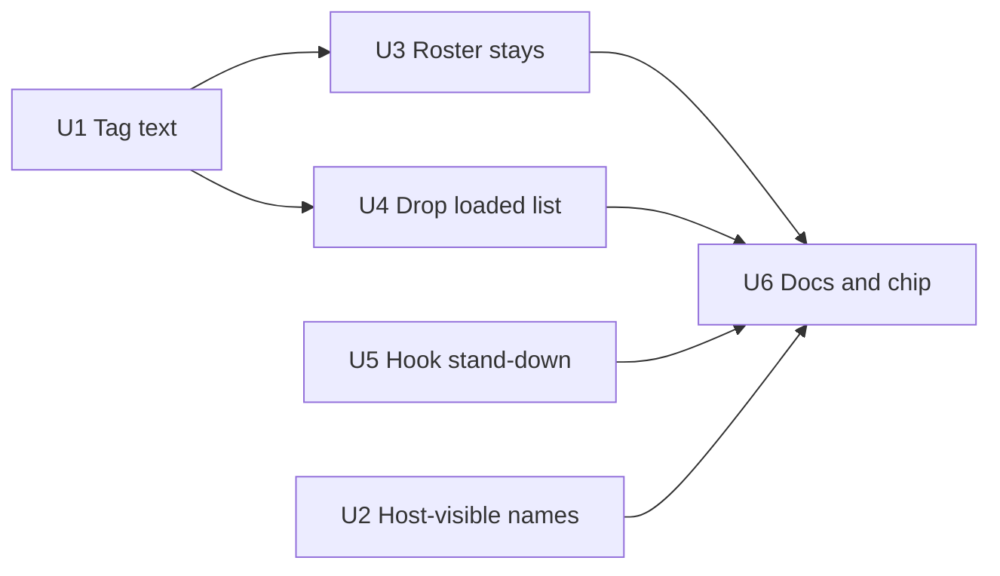

# feat: Advisory skill relevance for BB

**Target repo:** skill-gateway

## Summary

A BB turn keeps the host skill roster and receives one ignorable relevance tag, or no tag when lookup fails. A completed decision that nothing fits still says so. The tag names a skill the host can list and does not paste the skill body. The suggestion hook stays quiet on the session BB already owns.

---

## Problem Frame

Claude Code, Codex, OpenCode, and Pi already keep their skill rosters and add one advisory tag through the suggestion hook. BB still clears the roster and pastes a skill body into the turn. The model cannot ignore a bad paste, and a name that exists only in the private gateway library is a hint the model cannot follow.

---

## Requirements

- R1. A BB turn keeps the host skill roster, including when selection fails, the prompt is empty, the message is not a user message, or automatic selection is skipped.
- R2. A completed choice adds only the advisory tag for that skill. The tag contains the skill name and the existing ignore sentence. It does not contain the skill body, a file path, or an instruction not to read the skill file.
- R3. A completed decision that nothing fits adds the explicit "no skill in the roster" tag.
- R4. A failed lookup adds nothing. Silent reasons are `no answer`, `credential_unavailable`, `skill_excerpt_permission_required`, `not_an_implicit_skill_request`, `no_candidates`, `context_changed`, `disable-model-invocation`, any reason that starts with `rerank gave no answer`, and a thrown error.
- R5. The name in the tag is a skill the host roster can list. A skill that exists only in the private gateway library is not a candidate on the default path.
- R6. A prompt that starts with `/`, starts with a `<skill name=` tag, or contains the skill-mention marker skips automatic selection and does not add the tag.
- R7. While a BB session owns selection, the suggestion hook adds nothing for that same session. Other hosts, and a different session, still receive the hook's tag.
- R8. The ledger records an advisory tag when a skill name is attached. `inline` stays false. The plugin stops writing the per-session loaded list. Routes, token auth, settings, CLI, dashboard, server supervision, the mention provider, and the two TypeSafe requests stay as they are.

---

## Scope Boundaries

- Do not change the two TypeSafe requests, the gate and rerank policy, or the vendored policy file.
- Do not enable `skill-gateway-userpromptsubmit` or `skill-gateway-load-observer`. Do not disable `skill-suggestion-userpromptsubmit`. Do not enable the Codex skill-gateway plugin.
- Do not change the mention provider, dashboard layout, or server supervision.
- Do not upload the live host roster on the BB select request. The host-visible library is the existing manager root.
- Do not rewrite experiment notes, analytics labels, or the historical pass count labeled "Injected" on the Selection view.

### Deferred to Follow-Up Work

- Align the Selection view's "Injected" pass count with the suggestion wording, if that vocabulary should change later.
- Delete leftover `loaded:` keys already stored for old sessions. They become unread; no migration is required for this change.

---

## Context & Research

### Relevant Code and Patterns

- `src/suggestion-hook.ts` `suggestionText` is the spec for the tag and for silence. `src/vendor/jev-skill-suggestion/policy.ts` `suggestionBlock(skill, false)` is the tag text. The vendored file stays an unchanged upstream copy (`src/vendor/jev-skill-suggestion/UPSTREAM.md`).
- `src/jev-skill-suggestion.ts` `skillInjection` still appends the skill body, an "already loaded" line, or a file path. `src/select.ts` returns that string as `context`.
- `bb-plugin/server.ts` `POST /select` forwards `context` unchanged and writes `loaded:<sessionId>` when `inline` is true.
- `extensions/jev-skill-suggestion-bb.ts` clears `systemPromptOptions.skills` before selection, including on failure, and injects `context` only when it is non-empty. It already skips `/`, `<skill name=`, and the mention marker.
- `extensions/jev-skill-suggestion.ts` stands down when `SKILL_GATEWAY_BB_SESSION` equals the current Pi session, then clears the roster and injects the same context. The suggestion hook does not yet stand down.
- `src/search.ts` `defaultRoots()` lists the private gateway library first and `DEFAULT_ROOT` (`~/.skills-manager/skills`) second. `loadMerged` keeps the first copy of a name. Search and MCP use that merge and should keep it.
- The hook is launched from source (`skill-suggestion-userpromptsubmit` in the hooks manifest). BB runs the built `dist/select.js`.

### Institutional Learnings

- No `docs/solutions/` entries in this repo.

### External References

- None. The tag text and silent reasons already exist in this repo.

---

## Key Technical Decisions

- One mapping from `(name, reason)` to context text, shared by the selector and the suggestion hook. It calls the existing `suggestionBlock` and the existing silent-reason rules. It lives outside the vendored policy file so the hook and `select.ts` can both import it without an import cycle and without editing upstream policy.
- `suggest()` sets `context` from that mapping on every finish, including a completed no-fit. `inline` is false whenever a name is chosen. The injected-body set and the "already loaded" branch go away.
- Ledger `injection_kind` is `advisory_tag` when a name is attached, and `none` when it is not. `none` covers both the explicit no-fit tag and a silent failure. Do not reuse `inline_body` or `already_loaded_or_file_reference`; those described a pasted or omitted body.
- Default selection uses only `DEFAULT_ROOT`. An explicit `roster` or `root` on the select request stays an override. `defaultRoots()` and search stay merged, so the private library remains searchable.
- The opt-in Pi trial chooser emits the same context, so it also stops clearing the roster. Its library half uses `DEFAULT_ROOT` only, then still unions skills the host event already listed. The BB adapter does not gain a roster field.
- The suggestion hook stands down only when the turn's session id equals `SKILL_GATEWAY_BB_SESSION`. A set variable alone is not enough: child processes inherit it and must still be allowed to suggest.
- The composer chip keeps the skill name and the time. Its detail text says the skill was suggested, not injected.

---

## Open Questions

### Resolved During Planning

- Where the no-fit sentence is produced: in the shared mapping, not only in the hook. BB injects `context` from `select` and never calls `suggestionText` itself. Today a completed no-fit leaves `context` empty, so BB would stay silent.
- Whether the trial chooser is in scope: yes, because replacing `skillInjection` changes the text it injects. Leaving its roster clear in place would name a skill the model cannot see.

### Deferred to Implementation

- The userPromptSubmit field that carries the session id. The hook already reads `prompt` and `userPrompt`. Use the session id the hook runner actually sends. If that payload has no session id, leave the hook active and record that the stand-down could not be matched. Do not guess a field name in advance.

---

## High-Level Technical Design

This illustrates the intended approach and is directional guidance for review, not implementation specification. The implementing agent should treat it as context, not code to reproduce.

Unit order is not strictly linear. U1, U2, and U5 can land independently. U3 and U4 follow U1. U6 follows the behavior units.

---

## Implementation Units

### U1. Return the advisory tag from selection

**Goal:** `selectSkill` context matches the suggestion hook: a name tag, an explicit no-fit tag, or empty text. The skill body is no longer part of that text.

**Requirements:** R2, R3, R4, R8

**Dependencies:** None

**Files:**
- Create: `src/relevance-text.ts`
- Modify: `src/jev-skill-suggestion.ts`
- Modify: `src/suggestion-hook.ts`
- Modify: `src/select.ts`
- Modify: `extensions/jev-skill-suggestion.ts`
- Test: `test/select.test.ts`
- Test: `test/jev-skill-suggestion.test.ts`
- Test: `test/suggestion-hook.test.ts`

**Approach:**
- Move the silent-reason rules and the call to `suggestionBlock(skill, false)` into `src/relevance-text.ts`. `suggestionText` in the hook becomes a wrapper so current hook tests keep their import.
- At the end of every `suggest()` finish, set `context` from that function. A chosen skill sets `inline` false and does not append body lines. Stop recording the skill as already injected for a later paste.
- In both ledger writers (`src/select.ts` and the trial extension audit), record `advisory_tag` when `name` is set and `none` otherwise.
- Update the header comment on `src/select.ts` so it no longer says the host only suppresses the roster and injects instructions.

**Execution note:** Update the existing selection tests that expect an inlined body before changing the injection text.

**Patterns to follow:**
- `suggestionText` and `suggestionBlock` in `src/suggestion-hook.ts` and `src/vendor/jev-skill-suggestion/policy.ts`
- Ledger rows already written in `src/select.ts`

**Test scenarios:**
- Happy path: a roster whose chosen skill file contains a unique body sentence returns context with that skill name and the ignore sentence, and without the body sentence, `instructions follow`, or the skill file path. `inline` is false.
- Happy path: the same choice with that name already in `loaded` returns the same tag, not an "already loaded" line. `inline` stays false.
- Happy path: a second `suggest()` in the same chooser for the same skill still returns the name tag, not an "already loaded" line.
- Edge case: a completed rejection whose reason is `needs a skill 0.10 < 0.3` returns a null name, `inline` false, and context that says no skill in the roster appears relevant.
- Edge case: reason `nothing fits, best 0.10 < 0.3` returns that same no-skill tag.
- Error path: reason `credential_unavailable` returns a null name and empty context.
- Error path: reason `rerank gave no answer; no suggestion` returns empty context.
- Error path: reason `disable-model-invocation` returns empty context.
- Error path: the hook's `handle` still returns empty additional context when the selector throws.
- Integration: a mocked TypeSafe pair that picks one skill makes `selectSkill` record `injection_kind` `advisory_tag` when recording is enabled against a temp ledger, or the kind is asserted through the writer the tests already use. A rejection records `none`.

**Verification:**
- Chosen, no-fit, and silent results match R2–R4.
- No test still requires the skill body inside `context`.
- Both ledger writers use `advisory_tag` or `none`.

### U2. Limit default selection names to the host-visible library

**Goal:** The default catalog used to choose a tag name is the manager library the host roster is built from. The private gateway library stays available to search.

**Requirements:** R5

**Dependencies:** None

**Files:**
- Modify: `src/select.ts`
- Modify: `extensions/jev-skill-suggestion.ts`
- Test: `test/select.test.ts`

**Approach:**
- `libraryRoster()` with no explicit root loads `DEFAULT_ROOT` only.
- An explicit `root` or `roster` on the request is unchanged.
- The trial chooser loads its library half from `DEFAULT_ROOT` only, then unions skills already present on the host event.
- Do not change `defaultRoots()` or `loadMerged`.

**Patterns to follow:**
- `DEFAULT_ROOT` and `GATEWAY_LIBRARY` in `src/search.ts`
- Existing temp-library fixtures in `test/select.test.ts`

**Test scenarios:**
- Happy path: a temp manager root contains skill A, and a temp private library contains only skill B. The default roster builder, given those two roots, includes A and excludes B.
- Happy path: the same name in both roots is included once, and the file path used for that name is the manager copy.
- Edge case: an explicit `roster` argument that contains only B is still selectable. The override is not filtered.
- Edge case: an explicit `root` pointing at the private library still loads that root. This remains operator override.
- Integration: the trial roster builder, given a native skill C plus the two roots above, includes A and C and excludes B.

**Verification:**
- Default selection cannot return a name that exists only under `GATEWAY_LIBRARY`.
- Search still sees both roots because `defaultRoots()` is unchanged.

### U3. Leave the host roster in place

**Goal:** The BB adapter and the opt-in trial chooser attach the tag without clearing the host skill list.

**Requirements:** R1, R6

**Dependencies:** U1

**Files:**
- Modify: `extensions/jev-skill-suggestion-bb.ts`
- Modify: `extensions/jev-skill-suggestion.ts`
- Test: `test/bb-skill-adapter.test.ts`
- Test: `test/jev-skill-suggestion.test.ts`

**Approach:**
- Remove the assignment that sets `systemPromptOptions.skills` to an empty list in the BB adapter, including the failure path.
- Remove the same assignment in the trial chooser. Keep its stand-down when `SKILL_GATEWAY_BB_SESSION` equals the current session.
- Keep the BB skips for `/`, `<skill name=`, and the mention marker. Those skips return before a select call and add no message.
- Update the BB flag description and the file header so they no longer say the roster is withheld.
- A non-empty `context` is still returned as the hidden custom message. Empty `context` still adds no message.

**Patterns to follow:**
- The current skip and status-line behavior in `extensions/jev-skill-suggestion-bb.ts`
- The session stand-down already in `extensions/jev-skill-suggestion.ts`

**Test scenarios:**
- Happy path: a successful BB select leaves the original skill entry in `systemPromptOptions.skills` and returns a message whose content is the response `context`.
- Edge case: a prompt containing the skill-mention marker does not call BB, returns no message, and leaves the roster unchanged.
- Edge case: a prompt starting with `/` or `<skill name="x" location="y">` does not call BB and leaves the roster unchanged.
- Error path: a failed BB response returns no message, sets the failure status, and leaves the roster unchanged.
- Edge case: an empty prompt and a non-user message do not call BB and leave the roster unchanged.
- Integration: with `SKILL_GATEWAY_BB_SESSION` equal to the trial session id, the trial `before_agent_start` returns no message and leaves the roster unchanged.
- Happy path: with the trial flag on and the BB session unset, `before_agent_start` leaves the native skill in the roster and returns the chooser's context.

**Verification:**
- No path in either extension assigns an empty skills list.
- Mention, slash, and skill-tag prompts still skip selection.

### U4. Stop writing the per-session loaded list

**Goal:** The plugin no longer tracks skills in order to avoid pasting the same body twice.

**Requirements:** R8

**Dependencies:** U1

**Files:**
- Modify: `bb-plugin/server.ts`
- Test: `test/select.test.ts`

**Approach:**
- Stop reading `loaded:<sessionId>`, stop sending `loaded` to the select entrypoint, and stop writing that key after a choice.
- Leave route shape, token auth, settings, and the forwarded `context` as they are.
- Update the plugin and route comments that say the adapter suppresses the roster and receives only the skill instructions.
- Do not add a new module only to host a test. U1 already proves `loaded` cannot change the tag.

**Patterns to follow:**
- The existing `select` function in `bb-plugin/server.ts`

**Test scenarios:**
- Happy path: covered by U1. A `loaded` list containing the chosen name does not change context and does not set `inline`.
- Edge case: no new scenario inside the plugin package. That package has no test runner. The implementer confirms the select payload omits `loaded` and that the session key is not written.

**Verification:**
- The plugin select path has no read or write of the session loaded key.
- `POST /select` still returns the entrypoint's `context` unchanged.

### U5. Stand the suggestion hook down for the BB-owned session

**Goal:** A Pi session with `--jev-via-bb` gets one tag, from the adapter. The hook does not add a second tag for that session.

**Requirements:** R7

**Dependencies:** None

**Files:**
- Modify: `src/suggestion-hook.ts`
- Test: `test/suggestion-hook.test.ts`

**Approach:**
- Before selection, if the payload's session id equals `SKILL_GATEWAY_BB_SESSION`, return empty additional context and do not call the selector.
- If the payload has no session id, do not stand down.
- Leave the manifest entries unchanged: the suggestion hook stays enabled; the two skill-gateway hooks stay disabled.

**Patterns to follow:**
- The session comparison in `extensions/jev-skill-suggestion.ts`
- `suggestionText` tests in `test/suggestion-hook.test.ts`

**Test scenarios:**
- Happy path: payload session `sess-1` with `SKILL_GATEWAY_BB_SESSION=sess-1` returns empty additional context and does not call the selector.
- Edge case: the same env value with payload session `sess-2` still calls the selector and returns the name tag.
- Edge case: payload with a prompt and no session id still calls the selector when the env var is set.
- Error path: env unset, selector returns a name, the hook still wraps that tag as additional context.
- Edge case: env set to `sess-1`, payload session `sess-1`, selector would throw; the hook still returns empty context and does not call the selector.

**Verification:**
- A matching session produces no hook text.
- A different session and a missing session id keep today's hook behavior.

### U6. Match the skill document and the chip to the contract

**Goal:** The skill document, the composer chip, and the short plugin description stop saying that the catalog is withheld or that a skill was injected.

**Requirements:** R8

**Dependencies:** U1, U2, U3, U4, U5

**Files:**
- Modify: `bb-plugin/skills/skill-gateway/SKILL.md`
- Modify: `bb-plugin/overlay.tsx`
- Modify: `bb-plugin/package.json`
- Modify: `README.md`
- Modify: `docs/code-map.md`
- Modify: `docs/jev-skill-suggestion-pi-trial.md`

**Approach:**
- Rewrite the skill document opening: the roster is visible, BB adds one ignorable tag, and this skill is how to search the library or inspect a decision. Remove the claim that the catalog is withheld on purpose. Remove the limit that says an already injected skill is re-referenced instead of inlined.
- Chip detail for a pass says the skill was suggested at that time, with latency when present. The chip label stays the skill name, or "No skill".
- Update the one-line plugin description that currently says hosts advertise no skill roster.
- Update the README chip sentence, the code-map sentence that says the BB adapter suppresses the roster, and the Pi trial note that says the roster is hidden and the body is inlined.
- Do not change the Selection view pass count.

**Patterns to follow:**
- Current chip structure in `bb-plugin/overlay.tsx`
- Current section order in `bb-plugin/skills/skill-gateway/SKILL.md`

**Test scenarios:**
- Test expectation: none — the plugin UI package has no test runner, and these edits are copy. Confirm the strings in source.
- Happy path copy: a pass detail contains "Suggested" and the time, and does not contain "Injected".
- Edge case copy: a failed gate detail can still say nothing was injected; that sentence describes a failed lookup, not a suggestion.
- The skill document says the roster is visible and that the tag can be ignored. It does not say the catalog is withheld.

**Verification:**
- A reader of the skill document can tell that the roster stays, the tag is ignorable, and this skill is for search and inspection.
- The chip still shows the chosen name and the time.

---

## System-Wide Impact

- **Interaction graph:** BB adapter `before_agent_start`, trial chooser `before_agent_start`, `POST /select`, `selectSkill`, and the userPromptSubmit suggestion hook. Only the matching BB session silences the hook.
- **Error propagation:** A thrown select error, a non-OK BB response, and a silent reason all leave the roster in place and add no tag. A completed no-fit is not an error and does add the no-skill tag.
- **State lifecycle risks:** Old `loaded:` keys remain in plugin storage and are unused. New turns do not write them. `inline` false means a stale writer cannot treat the tag as a body paste.
- **API surface parity:** `POST /select` still returns `name`, `context`, `reason`, `inline`, `latency_ms`, and `candidates`. `inline` becomes false for a chosen skill. Callers that branch on `inline` to mean "body was pasted" must treat false as "no body", which is the new steady state.
- **Integration coverage:** Unit tests cover the selector, both extensions, and the hook. They do not boot BB. The installed `dist/select.js` and the reinstalled plugin are the remaining runtime check, noted below.
- **Unchanged invariants:** Token auth, settings, `bb skill-gateway status`, `bb skill-gateway select`, dashboard routes, `manageServer`, the mention provider, the two TypeSafe requests, search merge roots, and the disabled hooks.

---

## Risks & Dependencies

| Risk | Mitigation |
| --- | --- |
| The hook and the adapter both add a tag when the payload has no session id | Stand down only on an equal session id. If the field is missing, leave the hook active and record that in the implementation notes rather than silencing every child that inherited the env var. |
| BB keeps running the old body paste because it executes `dist/select.js` | Rebuild and reinstall the plugin on the BB server machine after the source change. The hook path reads source directly and does not use that file. |
| A configured `libraryRoot` still points at the private library | Treat a non-empty root as an explicit override. The default empty setting uses the manager library. |
| Ledger readers assume `inline_body` or `already_loaded_or_file_reference` | New rows use `advisory_tag` or `none`. Old rows stay as written. Do not migrate them. |
| The trial chooser and the hook both speak when `--jev-skill-suggestion` and the suggestion hook are on, and BB is off | That pairing already existed. This plan does not change hook enablement. The trial chooser now leaves the roster up, so a second tag is advisory rather than a hidden-roster body paste. |

---

## Documentation / Operational Notes

- Skill document, README chip sentence, code map, Pi trial note, and the plugin description are U6.
- After the source change, rebuild the package and reinstall the plugin from `bb-plugin/` on the machine that runs BB, so `dist/select.js` matches source.
- Do not edit the hooks manifest. Confirm `skill-suggestion-userpromptsubmit` stays enabled and the two `skill-gateway-*` hooks stay disabled.
- Do not enable the Codex skill-gateway plugin.

---

## Sources & References

- **Origin document:** home repo `docs/bb-skill-gateway-handoff.md`
- Related code: `src/suggestion-hook.ts`, `src/jev-skill-suggestion.ts`, `src/select.ts`, `extensions/jev-skill-suggestion-bb.ts`, `bb-plugin/server.ts`
- Related plans: `docs/plans/2026-10-14-002-native-skill-slash-picker-plan.md`
